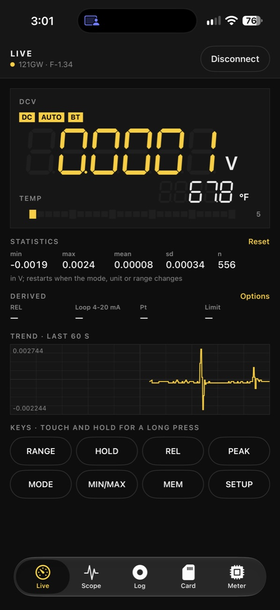
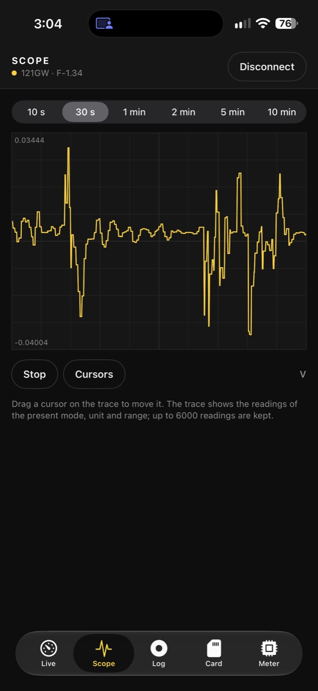
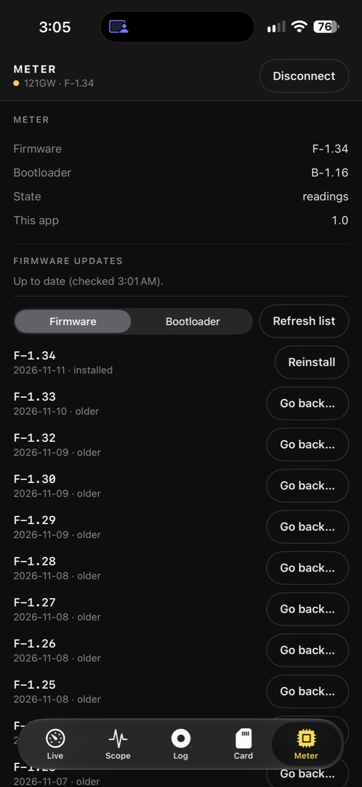

# 121GW for iPhone

Free on the App Store.

  
  
  

Taken on an iPhone 17 Pro Max connected to a 121GW with firmware F-1.34.

The companion of [121GW-Open-Firmware](https://github.com/zombu4/121GW-Open-Firmware) as a native iPhone app (Swift,
SwiftUI, CoreBluetooth).  The firmware and the emulator are on that repository's `main` branch, the desktop companion
on its `companion` branch; this app follows the companion's protocol and behaviour, ported module by module (the
source of each part is named at the top of its file).  Free: no account, no ads, no in-app purchases, no data
collected ([privacy policy](https://github.com/zombu4/121GW-Open-Firmware/blob/main/PRIVACY.md)).

## What it does

| | |
|---|---|
| Live | the reading drawn as the meter's seven-segment LCD with the decimal point and unit of every mode and range (the firmware's own tables; with the current clamp of firmware F-1.35 set, DCV, ACV, DCmV and ACmV show A or mA as the meter does), the small display, the symbols and the bargraph; statistics (min, max, mean, sd, n, restarting on a mode / unit / range change); derived values (REL %, 4-20 / 0-20 mA loop %, Pt100 / Pt1000 temperature, a limit test); a minute of trend; the meter's keys (touch and hold for a long press; SETUP after a confirmation) |
| Scope | the last 6000 readings on a scope grid with a time base from 10 s to 10 min, stop / run, two cursors (Δt, 1/Δt, ΔV) |
| Log | CSV recording of every reading (comma or semicolon format), the recordings to share or delete; also in the Files app under On My iPhone › 121GW. Voice notes (switch on the Log page, from 1.1): while recording, what you say is recognised on the iPhone only and written into a `note` column, in the row of the reading nearest to when you began the sentence (a sentence recognised too late for its row, or with no reading near it, gets a row of its own); no audio is kept |
| Card | the meter's SD card on the page Ld-bt: list, download (every window checked with a CRC-32, READZ packed reads from F-1.32, careful small pieces on the old BLE112 module), delete (cal.bin, EEVBlog.bin, BTLOAD.TMP protected), free space, sync to a folder, format (type FORMAT); leave page Ld from the phone (F-1.17) |
| Meter | firmware and bootloader versions, the update notice (Update both / Firmware only / Bootloader only / Later), every published release to install (also older ones, with the companion's warnings and INSTALL confirmation), a `.bin` file of your own (checked as the meter checks it), the clock (NTP sync, optionally on every connection), the meter's SETUP settings, the transfer diagnosis, the link details, a shareable diagnosis report, the event log |
| Link | version and bootloader questions at each connection, page Ld detection, the heartbeat 0xFE / 0xFD (F-1.26) with the alive check and reconnection, "meter offline" after a minute, link 2 with its adaptive pace on the old BLE112 module (F-1.31), extended link diagnosis (F-1.15) and the clock measurement (F-1.17) in the report |
| Updates | over Bluetooth through the two-part bootloader's update mode (packed from B-1.15), or through the SD card with EEVblog's bootloader (page Ld-bt, then the key sequence), the first two-part bootloader install through Ld-bt (F-1.03 on); release archives checked against their published SHA-256 |

The meter accepts one Bluetooth connection at a time: close the desktop companion or any other Bluetooth app for the
meter first.  Turn Bluetooth on at the meter with a long press of PEAK.  The app keeps the connection and a recording
running in the background (Bluetooth background mode).

## Layout

    Package.swift            Meter121Kit: the protocol, no CoreBluetooth or SwiftUI (builds and is tested on Linux too)
    Sources/Meter121Kit/     Frames, Link2, Display, Keys, Clock, Session, Versions, Transfer, Card, MeterSettings,
                             Releases (zip, SHA-256, install plan), Derived
    Tests/Meter121KitTests/  ported from the companion's tests, with fake meters for the transfers, card and settings
    App/Meter121.xcodeproj   the iPhone app (Xcode 16 or newer, iOS 17 or newer)
    App/Meter121/            Link (CoreBluetooth, NTP), Model (the controller, recording, updates, report), Views

## Build and run

1. Open `App/Meter121.xcodeproj` in Xcode 16 or newer (it picks up the local package `Meter121Kit` by itself).
2. Target Meter121 › Signing & Capabilities: choose your team (a free Apple ID works for your own phone).  Change the
   bundle identifier `io.github.zombu4.meter121` if Xcode says it is taken.
3. Choose your iPhone as the run destination and press Run.  The simulator has no Bluetooth: it shows the pages only.

The protocol tests run without Xcode:

    swift test

## Status

Verified working: built in Xcode 27 and run on an iPhone 17 Pro Max with a 121GW on firmware F-1.34 and bootloader
B-1.16 (live readings, statistics, trend, release list), in portrait and landscape.  The protocol package passes its
47 tests (`swift test`).

## Licence

See [LICENSE](LICENSE): free for personal, school and non-profit use; no sale or bundling except by the copyright
holder and EEVblog.
